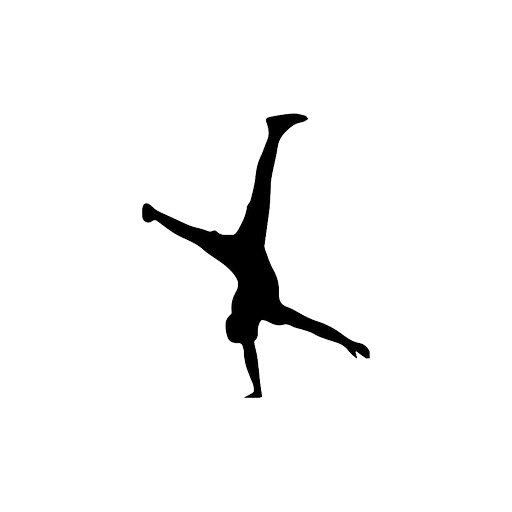

<p align="center">
  
</p>

<h1 align="center">Dopamine</h1>

<p align="center">
  A calisthenics workout tracker for Android. Log your sets, plan routines, track calories and streaks,
  and share your progress phone to phone, all stored privately on your device.
</p>

<p align="center">
  <a href="https://github.com/Abid109/Dopamine/releases/download/latest/Dopamine.apk"><b>Download the APK</b></a>
  &nbsp;·&nbsp;
  <a href="https://github.com/Abid109/Dopamine/wiki">Wiki</a>
  &nbsp;·&nbsp;
  <a href="https://github.com/Abid109/Dopamine/issues">Report a bug</a>
</p>

---

## Features

| Area | What you get |
| --- | --- |
| **Dashboard** | Today's sets, calories burned, streak, active time, lifetime burn, daily goal progress and a weekly burn chart. |
| **Log Workout** | A built-in library of 18 calisthenics movements, or add your own custom exercise. Calories are estimated from your bodyweight. |
| **Calendar Planner** | Monthly calendar showing logged and planned days, with ready-made routine templates. |
| **Notes & Journal** | Tagged training notes for cues, routines and reflections. |
| **Profile & Bio** | Name, photo, age, weight, height, BMI rating, level, objective and daily targets. |
| **Share & Receive** | Send data to another phone with QR codes or a file. The receiving phone chooses exactly which changes to import. |
| **Timers** | Rest timer with presets and a session stopwatch that keeps accurate time when you switch tabs. |
| **Reports & Backup** | PDF fitness report that opens in your PDF viewer, plus JSON export and import. |
| **Themes** | 7 colour themes, 6 accent colours, 2 font scales and a 12/24-hour clock. |

## Install

1. Open the [latest release](https://github.com/Abid109/Dopamine/releases/tag/latest) on your phone.
2. Download **Dopamine.apk**.
3. Open the file and allow installs from your browser or file manager if Android asks.

Full steps and troubleshooting are on the [Installation](https://github.com/Abid109/Dopamine/wiki/Installation) wiki page.

> The first launch needs an internet connection to load styling and fonts. After that the app works fully for logging, planning and notes.

## Your data stays with you

Everything you enter is saved on your phone. There are no accounts, no servers and no tracking. Data only leaves your phone when you choose to share it. See [PRIVACY.md](PRIVACY.md).

## Share between phones

Open **Share & Receive** in the sidebar.

- **Send:** tick what to include, then show QR codes or send a file through the Android share sheet.
- **Receive:** scan the codes or import a file. Received data is kept in a list. Nothing on your phone changes until you review it and pick what to import. You can delete any received file.

## Build from source

The app is a single web page (`www/index.html`) wrapped as an Android app with [Capacitor](https://capacitorjs.com). The APK is built automatically by GitHub Actions on every push to `main` and published under Releases.

```bash
npm install
npx cap add android
npx cap sync android
cd android && ./gradlew assembleDebug
```

Details are in [Building from Source](https://github.com/Abid109/Dopamine/wiki/Building-from-Source).

## Project layout

```
www/                 The app (index.html and vendor/ QR libraries)
android-res/         Launcher icons applied during the Android build
.github/workflows/   APK build and wiki sync
wiki/                Source of the GitHub wiki pages
docs/assets/         Images used in the docs
```

## Contributing

Ideas and fixes are welcome. Read [CONTRIBUTING.md](CONTRIBUTING.md) first.

## License

Released under the [MIT License](LICENSE).
